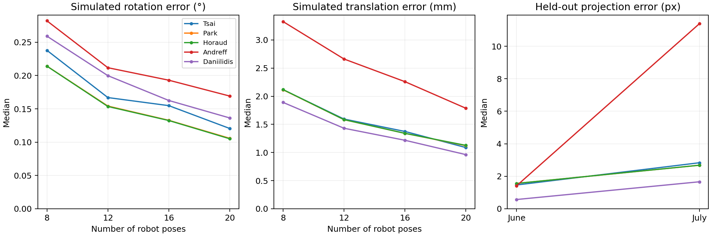

# Eye-to-hand calibration on DENSO robot motions

## Reproduce

Use Python 3.12 and install the versions in requirements.txt. Place Data4Osinchuk.zip next to laboratory.py and run the command in README.md. The original images are supplied separately. Per-view held-out measurements and the June correction log are committed in results/thesis/. The output tables retain trial number, seed, pose count, observed error and solver failures.

## Measurement model

G maps gripper to base, C maps target to camera, X maps target to gripper, and Y maps camera to base. Each observation obeys G X = Y C. OpenCV takes inverse(G) and C to recover Y. The angular error is the geodesic rotation angle. Translation error is the Euclidean distance between frame origins in mm. Robot angles use Rz Ry Rx, following the supplied MATLAB file.

The 3 July replay uses all 20 logged robot poses. The synthetic camera and mount are fixed nominal transforms fitted once from the 18 unambiguous photographs using Park and a rigid mean. The fitted intrinsics and five OpenCV distortion coefficients model the lens. Each synthetic observation projects the 88 corners of a 12 mm checkerboard through that camera and estimates the target pose with iterative PnP. Synthetic truth is the transform used to generate the data. The full-data nominal fit is used only to parameterize the simulation.

Each of 100 seeded trials draws a permutation of the 20 poses. The 8-, 12-, and 16-pose subsets are nested and all methods use the same observations. Exact trials use zero noise. Low and high noise use per-axis robot rotation standard deviations of 0.1° and 0.5°, position noise of 0.5 and 2 mm, and independent corner noise of 0.25 and 1 px. These are sensitivity scenarios, with a fixed robot trajectory, fixed camera intrinsics and independent Gaussian perturbations. At 20 poses and zero noise the permutations represent the same geometric dataset.

## Laboratory validation

The June series supplies 15 paired views. Its second folder duplicates the images and robot table. Eight table entries above 10,000 in magnitude were divided by 1,000, treating them as missing decimal points. The input and inferred values are in june_corrections.csv. July supplies 20 labeled views. P47 and P48 have identical PNG bytes paired with different robot poses. Both images are excluded from laboratory scoring. The 9 July journal and HALCON pattern runs were outside the paired OpenCV image experiment.

For each of 15 June and 18 July held-out poses, the intrinsic matrix, distortion, hand–eye transform and fixed gripper-to-target transform were fitted on the other views in the same series. The mount is estimated by averaging translations and projecting the mean rotation onto SO(3). The held-out robot pose predicts the checkerboard pose. Its projections are compared with measured corners, using the root mean squared Euclidean pixel distance per corner. Its 3D pose is compared with PnP from the held-out image. These scores measure prediction consistency. The archive provides no independently surveyed camera pose for this analysis. Training sets overlap across folds. Tiny differences between medians do not establish superiority.

## Results

### Trajectory simulation with 20 poses and low noise

|Method|Median angle (°)|Median translation (mm)|95th percentile (mm)|Failed / 100|
|---|---:|---:|---:|---:|
|Tsai|0.1205|1.088|2.059|0|
|Park|0.1058|1.122|2.156|0|
|Horaud|0.1051|1.127|2.160|0|
|Andreff|0.1691|1.786|3.485|0|
|Daniilidis|0.1363|0.962|1.993|0|

### Held-out image predictions

|Series|Method|Median angle (°)|Median translation (mm)|Median pixel RMSE|95th percentile pixel RMSE|
|---|---|---:|---:|---:|---:|
|June|Tsai|0.0779|0.433|1.465|3.832|
|June|Park|0.0730|0.422|1.559|4.119|
|June|Horaud|0.0729|0.422|1.561|4.116|
|June|Andreff|0.0797|0.582|1.414|3.818|
|June|Daniilidis|0.0745|0.212|0.571|2.307|
|July|Tsai|0.1467|0.653|2.833|5.873|
|July|Park|0.1239|0.559|2.680|5.516|
|July|Horaud|0.1241|0.558|2.680|5.535|
|July|Andreff|0.1265|1.829|11.386|20.900|
|July|Daniilidis|0.1342|0.646|1.662|4.994|

Daniilidis gave the lowest median image prediction error in both series. Park and Horaud gave almost identical median 3D consistency on July data. Absolute camera pose error can be reported for the simulated trials. The pose and pixel benchmark folders additionally contain the earlier controlled orientation-profile experiments.

## Manuscript and regenerated outputs

The compiled manuscript is `paper/main.pdf`; its source is `paper/main.tex`. It preserves the introduction and initial thesis formatting, uses the five methods as its theoretical framework, starts each main chapter on a new page, and contains both controlled models, the recorded-trajectory replay, laboratory preprocessing/validation, the circular diagnostic, all completed result types and their limitations. The appendices print all 270 controlled condition summaries and all 60 replay summaries.

Run `python scripts/build_paper_results.py` after installing `requirements-paper.txt` to rebuild the LaTeX tables and paper figures from the committed records. This also rebuilds `real_summary.csv` from `held_out.csv` and `june_held_out.csv`. The fitted nominal geometry is recorded without rounding in `geometry_metadata.json`. This formatting command does not rerun calibration.

The controlled nearly single-axis, high-noise conditions have very large finite translation tails; the 32-pose Daniilidis 95th percentiles reach approximately 60.3 m and 51.7 m for the pose and pixel models. Therefore the favourable replay and held-out medians above are condition-specific.

The circular diagnostic uses nine detected grids and supports pose-ID rotation consistency (median 0.077 degrees, maximum 0.383 degrees). Its naive row-order baseline filters image detections before selecting the first robot rows (median 13.989 degrees); pairing before filtering instead gives 12.997 degrees. The full circular-target transform and physical spacing remain unvalidated. The real-validation loop currently aborts on a solver exception; all recorded 165 predictions completed.

See `docs/reproducibility-check.md` for the rerun record and `docs/citation-map.md` for the revised manuscript provenance.
